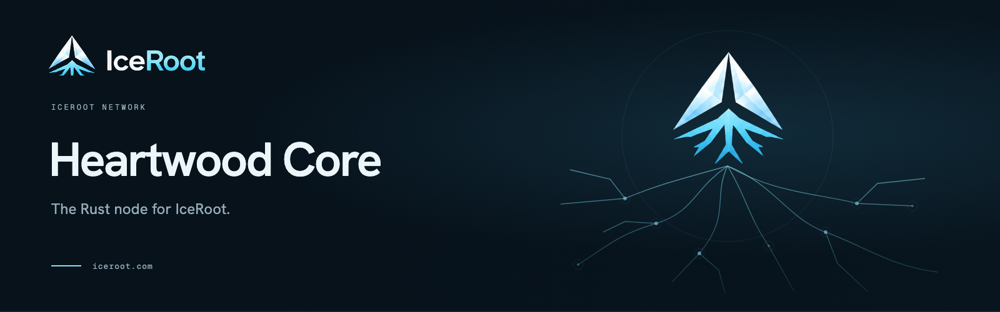

# Heartwood Core

The Rust implementation of IceRoot's node software. This repository currently provides cryptography, transaction and block codecs, network configuration, the headless state machine (wallets, delegates, rounds, transaction handlers, block application and reversal), the peer-to-peer wire codec, client and server, the store (SQLite), the transaction pool, block processing, the public API (38 routes and its OpenAPI document), the forger, the `heartwood` binary (a relay that follows a network and serves the peer-to-peer protocol and the public API, a forger process that forges through its relays, the optional `core` role that runs both in one process, a process supervisor, the recovery commands, the operator commands `top`, `env`, `config` and `service`, `network generate`, a local devnet and a read-only diagnostics command with its protocol server), and a differential-testing harness.

[Core overview](https://docs.iceroot.com/core/overview/) · [Build from source](https://docs.iceroot.com/core/installation/) · [Architecture](https://docs.iceroot.com/core/architecture/) · [Protocol design](https://docs.iceroot.com/core/protocol-design/) · [Operating a node](docs/operating.md)

## Build and test

Install Rust 1.98 or later with rustfmt and Clippy.

```sh
make check
```

This builds the workspace, checks formatting and lints, runs tests against committed vectors (the integration-tagged tests included), builds the documentation with warnings as errors, and checks release features and the crates' line ceilings. `make help` lists individual targets.

```sh
cargo test -p heartwood-crypto --locked
cargo test -p heartwood-crypto --locked --all-features
cargo test -p heartwood-database --locked
cargo test -p heartwood-pool --locked
cargo test -p heartwood-blockchain --locked
cargo test -p heartwood-api --locked
cargo test -p heartwood-core --locked
```

The peer-to-peer client has its own target, which `make check` also runs:

```sh
make test-p2p
```

It lints and tests `heartwood-p2p` without and with its test feature. [Compatibility and testing](docs/compatibility.md#heartwood-p2p) describes its tests against a mock peer and a reference node.

The forger and the commands have their own targets too, which `make check` also runs:

```sh
make test-forger
make test-cli
```

They lint and test `heartwood-forger` and `heartwood-cli` with and without their features. `make forger-crash` kills a forger at random moments against a mock relay and checks that no slot gets two different blocks, and `make forge-replay` rebuilds a corpus's blocks through the forger. [Compatibility and testing](docs/compatibility.md#heartwood-forger) describes these tests.

Release builds must select one package at a time, for example `cargo build --release -p heartwood-crypto`. Do not use `--workspace` for releases: the test harness enables features that must not enter production packages.

## Run a relay

```sh
cargo build --release --locked -p heartwood-core
target/release/heartwood relay run --network <name>
```

`heartwood relay run` (or `relay:run`) takes the reference's flags and reads the reference's configuration of the network: `app.json`, `peers.json`, `.env` and the four `crypto/*.json` files in the node's config directory (`~/.config/<token>-core/<network>` on Linux, token `solar` unless `--token` or `config.json` names another; a token or network name holds letters, digits, `-` and `_` only; the `CORE_PATH_*` variables move each directory). It keeps its store in the data directory and serves the public API on `CORE_API_PORT` (4003). The relay follows the network as a client of its peers, and its peer-to-peer server (`CORE_P2P_PORT`, 4002) takes the blocks and transactions its peers push and serves its forger. SIGINT or SIGTERM stops it gracefully after the current job. Where the reference leaves a resource unbounded against a hostile peer or client (a socket that never reads its answers, the ban list, the peers of one subnet, slow port probes and peer sources, the chunk cache, a flood of API requests), the relay bounds it, and a downloaded block that no honest peer would serve counts against the peer that served it. [Compatibility and testing](docs/compatibility.md#heartwood-core) lists the settings it honours and where it differs from a reference relay.

## Run a forger

```sh
target/release/heartwood forger run --network <name>
```

`heartwood forger run` (or `forger:run`) holds the delegates' keys and forges their blocks through its relays; it opens no listening socket. It reads the same config directory as the relay: the forger's profile of `app.json`, whose forger component lists the relays in `hosts` (in order; the relay at `127.0.0.1` on `CORE_P2P_PORT` by default), `delegates.json` with the delegates' private keys (`{"keys": [...]}`; a file its group or others can read or write is refused) and the four crypto files. Each relay must list the forger's address in its p2p `remoteAccess`, and it serves its forger only from those addresses. The forger signs its relay's status only for a relay it reaches over loopback, and the relay counts a delegate as on this node only when the forger's session proves it holds the delegate's key. A signing record in the data directory keeps the forger from signing two different blocks for one slot, across restarts too. SIGINT or SIGTERM lets a block post in flight finish, then stops it.

`heartwood relay start` and `heartwood forger start` run a role under the built-in supervisor, as a daemon unless `--daemon false` is given, and `stop`, `restart`, `status` and `log` manage it. `heartwood network generate --network <name> --seed <text> --out <dir>` writes a new network's crypto files, its keys and one node's configuration.

## Operate a node

[Operating Heartwood Core](docs/operating.md) is the guide: the requirements, the files, the keys, the ports, the logs, upgrades and what goes wrong. Nodes run on Linux only. Every command block of its Linux flows runs as written in `make ops-doc-check`, which builds the release binary and runs them on two private machines (network namespaces, no root) with scratch home directories. The flows, as commands (a test network's files come from `heartwood network generate`; a real network's come with its release):

```sh
# a relay on a machine of its own, with no key anywhere
target/release/heartwood config publish --network <name>      # the template; then the network's crypto files and its seeds in peers.json
target/release/heartwood relay start --network <name>

# a relay and a forger on one machine
target/release/heartwood relay start --network <name>
target/release/heartwood forger start --network <name>
target/release/heartwood top                                  # every running instance of the token, with status's columns

# a forger on a second machine driving a relay
#   on the relay's machine: list the forger's IP address in the p2p component's remoteAccess in app.json, then restart the relay
#   on the forger's machine: copy delegates.json (mode 600) and the signing record, list the relay in the forger's hosts, then
target/release/heartwood forger start --network <name>

# the optional core role: a relay and its forger in one process, with the keys in the process that serves the network
target/release/heartwood core start --network <name>
```

`heartwood config forger private-key --privateKey <64 hex digits>` puts one key into an instance's `delegates.json` (which must exist) at mode 600, and the forger refuses a key file that its group or others can read. `heartwood env get|list|set|paths` reads and changes an instance's `.env` and prints its five directories. `heartwood service install --role <relay|forger|core> --network <name>` writes a systemd unit and prints the commands that enable it; it calls no service manager, and under a unit `status` reports `online (systemd)` and `stop` names the `systemctl` command. A forger on another machine is not attested by its relay in this stage, so its delegates show as offline to the other nodes; the guide says what that costs. Each role writes its own logs, in `~/.local/state/<token>-core/<network>`, and `heartwood <role> log` follows what it prints.

## Recover a relay

```sh
target/release/heartwood snapshot rollback --network <name> --height <h>
target/release/heartwood pool clear --network <name>
target/release/heartwood state clear --network <name>
```

`snapshot rollback` (or `snapshot:rollback`) rolls a stopped relay's store back to the last block of the round before height `h` (`--number n` counts n blocks down from the tip), holding the relay's lock while it works, so the relay cannot start meanwhile. At its next start the relay rebuilds its state from the stored blocks and syncs the rest from its peers. `pool clear` and `state clear` ask first (`--force` skips the question) and leave the reference's marker file in the relay's temp directory: at its next start the relay empties its transaction pool, or rebuilds its state from the genesis block. The commands take the relay's `--token` and `--network`, print the reference's lines and exit with status 1 on every refusal. [Compatibility and testing](docs/compatibility.md#heartwood-core) gives the rule a marker file must meet and where the commands differ from the reference's.

## Diagnose an instance

```sh
target/release/heartwood doctor --network <name>
target/release/heartwood doctor --network <name> --json
```

`heartwood doctor` examines one instance on the host it runs on and says, check by check, what is fine, what needs attention and what is broken, with the command or setting that fixes it. It only reads: it writes no file, sends no signal, never reads a key file, and its only network use is HTTP GETs to its own relay's API on a loopback address. Its report is redacted by default (addresses, the home directory, the user and host names), so it can be pasted where others read it; `--json` prints it in a documented format. `heartwood doctor mcp` serves the same checks to the operator's own client over SSH, read-only and without a listener. [The doctor](docs/doctor.md) describes the checks, the report and the exit codes, and [its protocol server](docs/doctor-mcp.md) the setup over SSH.

## Run a local devnet

```sh
target/release/heartwood devnet --dir <dir> init --validators 5
target/release/heartwood devnet --dir <dir> start
target/release/heartwood devnet --dir <dir> status
target/release/heartwood devnet --dir <dir> stop
```

`heartwood devnet` runs a devnet on one Linux host: each validator node is a relay and a forger under their supervisors, each node at its own loopback address (node k at `127.0.0.(10 + k)`, P2P on port 6002, the API on 6003; `init --address-prefix` puts a devnet on other addresses, so that devnets can run side by side). It is the one-machine mode for five nodes: it needs no root on Linux. `init` generates the chain from a seed and writes each node's configuration and share of the delegates' keys (`--core` makes each validator one `core` process, `--failover 1:1,6,7` lets a forger use several relays, `--relays N` adds relay-only nodes); `status` shows the processes, the heights and whether every relay has the same chain (`--json` and `--resources` print more), and `stop-node`, `start-node`, `restart-node`, `reset`, `wait`, `logs` and `env` act on the nodes. `heartwood devnet run <scenario>` runs a scenario file on it with the harness's runner. A node refuses to start outside a network named `devnet` or on an address that is not loopback.

## Components

| Path | Purpose |
| --- | --- |
| `packages/crypto/` | Keys, signatures, addresses, codecs, transaction rules, milestones and the dynamic fee floor |
| `packages/kernel/` | Round and slot arithmetic, block chaining, the clock seam, event names, log levels, node directories, `.env` files and the strict loader of a network's crypto files |
| `packages/logger/` | The reference's log lines, console and file output, daily rotation; control characters in a message are escaped, so one call writes one line |
| `packages/state/` | Wallets, delegates, rounds, block application and reversal, genesis, the supply check, the state digest and the records a restart reads back |
| `packages/transactions/` | The six transaction handlers, the fee check and the pool-entry checks |
| `packages/p2p-wire/` | The peer-to-peer wire codec: nes frames, the protobuf messages of the public routes, list framing and the signed peer status |
| `packages/database/` | The store: one SQLite file per node with the chain tables, the state tables and the checks run at every start, and a read-only opener that the doctor uses |
| `packages/pool/` | The transaction pool: admission with the reference's checks, codes and messages, storage, queries, collation and the online record |
| `packages/blockchain/` | The blockchain component: the block processor, jobs committed to the store, the node thread, the job queue, the state machine with fork recovery, and a node's start (first start, restart from the state tables, or replay from the genesis block) |
| `packages/p2p/` | The peer-to-peer protocol: the client side as the relay uses it (nes sessions over WebSocket, requests and reply checks, peer acceptance and verification, discovery, downloads and broadcasts) and the relay's server (the listener, bans, inbound limits, the route controllers and the forger's status attestation) |
| `packages/forger/` | The forger: the slot loop its relay drives, the relay client with failover and call deadlines, block assembly and signing through a persisted signing record, the key file and the status attester |
| `packages/cli/` | The commands' library: the colon aliases, instances, a built-in process supervisor and the role commands, `top`, `env`, `config` and the systemd units of `service`, the markers of the recovery commands and their trust rule, the files of `network generate`, a local devnet with one loopback address per node, and the doctor: its checks, its report and redaction, and its protocol server |
| `packages/api/` | The public API a relay serves: the block, blockchain, delegate, node, peer, round, transaction, vote and wallet routes and the OpenAPI document, with the reference's envelope, query grammar, search engine, pagination, headers, rate limit and semaphore |
| `packages/core/` | The `heartwood` binary: the relay, forger and core roles (`run`, `start`, `stop`, `restart`, `status`, `log`), the recovery commands (`snapshot rollback`, `pool clear`, `state clear`), `top`, `env`, `config`, `service`, `network generate`, `devnet` and `doctor`, with the roles' configuration, process locks, signals and graceful shutdown |
| `tools/difftest/` | Compatibility harness and command-line tools: the comparisons, the lockstep producer, the scenario runner and the checks of live runs |
| `docs/operating.md` | The operator guide, checked by `make ops-doc-check` (`tools/ops-doc-check.sh`) |
| `tools/oracle/` | Reference execution, container builds and vector generation |
| `packages/*/tests/vectors/` | Committed vectors of each crate, with checksums and source metadata |
| `fuzz/` | Decoder fuzz targets, the state machine's apply and revert targets, the state's records, the pool, the peer-to-peer client's session, reply checks and download path, the peer-to-peer server's session, the forger's internal bodies and status offers, the API's query grammar and request heads, and the address and transaction JSON decoders |

The current implementation uses the retained reference cryptography and transaction formats. Proposed protocol features in the whitepaper describe a separate target; they are not all implemented here.

## Compatibility

The reference is [solar-core-ref](https://github.com/iceroot-network/solar-core-ref), based on Solar Core 4.3.1 with a documented patch series. Over the eleven crates that hold vector classes, the committed L0 vectors give 9,172 equal comparisons and 247 documented differences, with no record skipped. L1 (random cases against the reference, one call each), L2 (reference devnet chains replayed block by block through the store and through the block processor, with a state digest at every height and restarts by every start path, and every block rebuilt by the other side's forger), L3 (one scenario on a reference devnet, observed by a reference relay and by a Heartwood relay; and one scenario on a devnet of reference nodes and on a devnet of Heartwood relays and forgers, with a Heartwood devnet through faults and forger failover) and L4 (reference devnets with Heartwood relays: restarts, a sync from an empty store, a partition and its heal; and reference nodes served by Heartwood relays) run as well, and the rollback command's cases are replayed on each test chain, target by target, against the reference's own command and start.

In the runs with reference nodes on Heartwood relays, every reference node accepted the Heartwood relays and listed their API ports, none banned one or refused one of its replies, a reference relay synced from a Heartwood relay alone as fast as from a reference relay, a reference relay verified the status attestations of Heartwood forgers and its forger rebuilt their blocks byte for byte, the recovery commands left a live relay's store as the reference's commands leave a reference node's, and the reference's own peer client got the same answers, socket outcomes and bans from a Heartwood relay as from a reference relay. A reference node behind a relay on the minority side of a partition did not always follow the heal by itself, with a reference or a Heartwood relay in that place.

Beyond the vectors, the harness forges chains of its own beside the reference and judges them (`make lockstep`, `make lockstep-batch` and `make l2-batch`), runs scenario suites on both implementations (`make scenario`, `make suites`), runs reference and Heartwood forgers on one chain, and fuzzes the API's queries and request heads and the address and transaction JSON decoders (`make fuzz-api`, `make fuzz-codec`, with their replays through the oracle).

See [compatibility and testing](docs/compatibility.md) for exact boundaries, oracle prerequisites, vector classes, release requirements and regeneration instructions. Oracle runs are isolated from the network. Standard Rust checks use committed vectors and do not require the reference checkout or Docker.

## Contribute

[Contributing](https://github.com/iceroot-network/.github/blob/prod/CONTRIBUTING.md). Work on `dev`. Production changes reach `prod` through a reviewed `dev` → `prod` pull request.

Heartwood Core is licensed under the [Apache License, Version 2.0](LICENSE). [NOTICE](NOTICE) preserves ARK Core and Solar Core attribution. External vector sources and checksums remain alongside the vector files.
